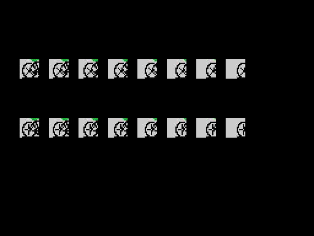

# Findings

Everything here is measured on this cartridge, with the tools in `tools/`.

## The world records live in RAM

The twelve bytes INIT copies from `0x40CF` to `0xE053` are the four marks to
beat: **1'45"34** for cycling, **17.97 m** for the triple jump, **100 points**
for curling and **5.90 m** for the pole vault. They are the only values in the
whole work RAM that do not start at zero.

They sit in RAM rather than ROM because the game **overwrites them**: `0x93D1`
writes the cyclist's time straight over the record as soon as it is improved.
The ROM holds no record at all, it holds a starting value.

The two that can be checked match the cartridge's own moment: the **17.97 m**
are Willie Banks's, from June 1985, and the **5.90 m** are Sergei Bubka's, from
1984.

And there is a third dated mark where you would not look for one: of the eight
triple jump bars, the sixth is **17.89 m**, which was Joao Carlos de Oliveira's
world record.

## The cartridge defends itself: copy protection

Two instructions in the start-up write inside the cartridge itself:

- **0x4013** puts a `pop hl` and a `ret` over the `djnz` at 0x412F.
  It loads `0xC9E1` into HL and drops it in one go: in memory those two
  bytes are `E1 C9`, which read as `pop hl` and `ret`.
- **0x4040** leaves a zero at 0x413B, which is not data: it is the operand of
  the `jp` at 0x413A. In memory that turns it into `jp 00000h`, a dead reset.

**Neither of them does anything here.** The cartridge runs from ROM, and ROM takes no
writes: that is why they look like dead code. They are not. A pirated cartridge is a
copy loaded into **RAM**, and there the write does land and breaks the game.
Doing nothing on the original is exactly the point.

This is no one-off idea in this cartridge: the same pair —a write over a `djnz`
and another over the operand of a `jp`— turns up in ten cartridges of this
series, always in the same two start-up routines. **Manuel Pazos** identified
them in his disassembly of RC-727, where he named them `ReadKeys_AC` and
`VRAM_writeAC`.

## The demo is a recorded game

Each event has its own tape of controller readings stored in ROM, and the loop
feeds it frame by frame as if it were the joystick. That is why the demo always
does exactly the same thing, down to the marks.

**Cycling has no recording.** There the rival moves off `ld a,r` —the DRAM
refresh register, which climbs with every instruction— used as a die. It is the
only event whose demo never comes out the same twice.

## Real sine and cosine

The table at `0x7346` is ninety degrees of sine, one byte per degree, with 0xFF
at ninety. With it and a quarter-turn offset you get both components of any
angle.

And in curling the angle is never worked out at all: the stone's two curves
**normalise the vector** and keep the two components. The stone travels
straight without the cartridge ever knowing how many degrees it is on.

## The period table has twelve values, not ten

It looked like ten entries with two indices left over. The two missing ones are
**hidden inside entry [0] of the track table**, the one written off as dead
because no track uses it: its two bytes are the continuation of the table next
door. `L_4D75` indexes it with the high nibble of the note byte, which reaches
0x0B, that is twelve.

It is the same trick as the pole vault bar table, pointed at **two bytes low**
so the index can start at one instead of zero.

## Three different scrolling tricks

All four events move the screen, and no two do it the same way. **Cycling**
keeps the circuit in two RAM windows and shifts them one column per frame. The
**jumps** store the runway twice, in place and shifted four pixels, and
alternate. **Curling** does not store half a sheet: it mirrors the right half
of the ice by hand, bit by bit.

## The cyclist is not a sprite

He is four tiles from the pattern table. To move pixel by pixel, `0x9CC7`
generates **eight copies of the drawing each shifted one pixel** when the event
starts, by rotating the bits; and it gets the mask for free, the 0xFF with
zeros pushed in from the left. Five sprites go on top, and those are the rider.

## The pole vault athlete is composed from two blocks

On the run-up the athlete comes out of no figure table at all: he is **three
pieces from `0x6E15` and whatever `0x6B6A` brings**, plus the sprite for the
tip and the twelve tiles of the pole. Both groups share the pattern counter,
because the patterns are decompressed consecutively into `0x1800`.

Checked against the emulator's VRAM on the first frame the cartridge draws him:
all six sprites identical and **zero of 2,048 pattern bytes different**.

## Ten bytes that are not data

Between the figures and the relative scripts there is a complete routine
**nobody calls**: it divides HL by 32 without losing anything off the top. That
is exactly what the curling stone's address arithmetic does by hand. Somebody
wrote it, stopped using it, and nobody deleted it.

## Konami's hidden mark

The last sixteen bytes are the title in katakana and backwards
—ハイパースポーツ3—, its length, the 0x33 of RC-733 and an 0xAA. **Nothing reads
it.** The mark was discovered by **Manuel Pazos**.

## What the pictures cost

All five screens are checked byte for byte against openMSX's VRAM, and the
check turned up things that looking at the drawing did not:

- The cycling screen is not finished by the routine that builds the event, but
  by **scene 0** (`L_91F9`), which brings the scoreboard frame and 140 bytes of
  sprite patterns. Without it half the scoreboard was missing.
- The two cyclists were not showing up because their row is written by a lone
  `ld a,020h / ld (0e0e3h),a` at `0x54CD`, inside the variable setup.
- The starting light is not a light: it is **a gun**, with its muzzle flash and
  its GO.
- Curling was missing **the two brooms** —which do not come from the figure
  table, they are a single sprite with the player's row plus 0x10— and the two
  line sprites, which are eight bytes copied verbatim from `0xA911`.
