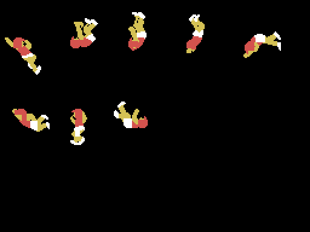

# Open questions

What is not known goes here, it does not get papered over.

## An invisible piece in the pole vault table

Figure [5] in the table at `0x6E33` has a piece with **dy = 114 and colour 0**,
that is, invisible and off the screen, with the same pattern as the piece after
it. Whether it is a leftover that stayed put or something the engine uses in a
case not yet seen is still open.

## A write that does nothing

`0x4010` does `ld hl,0c9e1h / ld (0412fh),hl`, and **`0x412F` is ROM**: the
write goes nowhere. The `0xC9E1` is `pop hl / ret`, so there was
self-modifying code there when that stretch lived in RAM. Still to be
confirmed.

## Ten bytes of a routine nobody calls

Between the figures and the relative scripts there is a complete routine —it
divides HL by 32 without losing anything off the top— that no instruction in
the cartridge points at. What it does is exactly what the curling stone's
address arithmetic does by hand a few lines below. What is not known is whether
it was deliberately abandoned or is a leftover from an earlier version.

## The logo dump

Of the five screens, the logo is the only one whose emulator dump has not been
squared yet: it needs its right instant found, the way the title screen did,
where the first dump taken as good turned out to be the logo under another
name. The other four are checked.

## The athlete's pose at build time

The triple jump and the pole vault draw the athlete in the starting pose, the
one the four bytes at `0x6DE6` name. The emulator never captures that pose
standing still: by the time a dump has him drawn, he is already running. The
pole vault could be checked against the first frame he appears on —six
identical sprites, zero differing pattern bytes— because the row and column had
not changed yet. The triple jump could not: there the athlete has already
moved, and its starting pose is left **unchecked against the machine**, derived
only from the listing.
