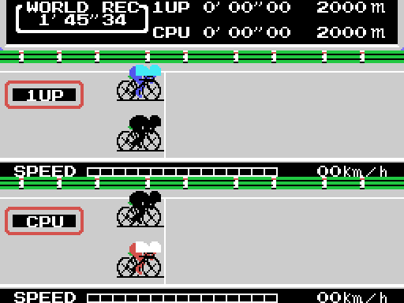
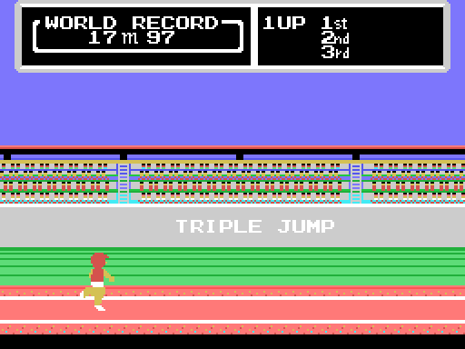
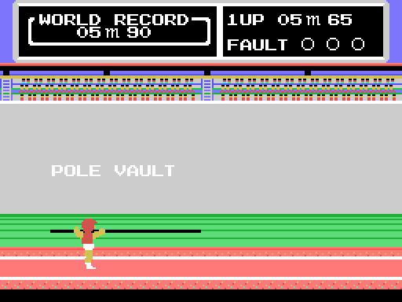
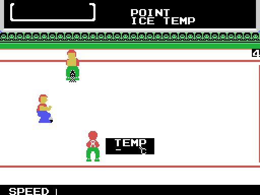

# The game

*Hyper Sports 3* is from 1985 and it is **four events**, in this order:

| (0xE06A) & 3 | event | label | starting mark |
|---|---|---|---|
| 0 | cycling | `CYCLING` | 1'45"34 |
| 1 | triple jump | `TRIPLE JUMP` | 17.97 m |
| 2 | curling | `CURLING` | 100 points |
| 3 | pole vault | `POLE VAULT` | 5.90 m |

The order is not guesswork: it is what the table at `0x5A90` says, the one the
code at `0x5913` indexes with `(0xE06A) & 3`. And that same index picks each
event's engine in the table at `0x5548`. Something turns up there you cannot
see while playing: **the triple jump and the pole vault share an engine**, both
enter through `0x5550`. Cycling and curling go to places of their own.

## Cycling

The event that departs most from the norm. **The circuit is not in VRAM.** It
lives in two RAM windows —`0xE140` and `0xE260`, nine rows of thirty-two tiles
each—, shifts one column per frame and is dumped whole to the screen.

And the cyclist is not a sprite either: he is **four tiles** from the pattern
table. So that tiles can move pixel by pixel, `0x9CC7` generates **eight copies
of the drawing, each shifted one pixel**, when the event starts, by rotating
the bits and feeding ones in from the left to get the mask for free. On top of
those four tiles go five sprites, which are the rider.

In each player's window you can see the other one, drawn with six tiles instead
of four, sixteen rows higher up.

## The triple jump and the pole vault

They share a screen and an engine; only the bar and the length of the runway
change. The runway is stored **twice**, in place and shifted four pixels, and
the game alternates between them: that is why it moves half a tile at a time.
The shifting is done in RAM, with chained `sla` and `rl` across twelve
consecutive tiles.

The marks for both events sit in BCD at `0x757D`: eight for the triple jump,
from 13.00 to 20.00 m, and ten for the pole vault, from 5.65 to 5.94. The sixth
triple jump bar, **17.89 m**, was Joao Carlos de Oliveira's world record.

The athlete is not a sprite, he is **two to seven 16x16 sprites** placed side
by side, and their patterns are **not sitting in VRAM beforehand**: they are
decompressed there on every frame. That is how the cartridge can hold hundreds
of poses that would never fit at once in the 2 KB of sprite patterns.

On the pole vault run-up the athlete does not even come out of a figure table:
he is composed from **two different blocks** —three pieces from `0x6E15` and
whatever `0x6B6A` brings— plus the sprite for the pole tip and the twelve tiles
of the pole itself.

## Curling

The heaviest of the four. The right half of the ice is **stored nowhere**: it
is mirrored by hand, bit by bit, as the screen is built. The house rings are
drawn by a clipped-rectangle routine that takes the screen's scroll into
account, and at the start they fall outside the view.

And the stone is not steered with angles: the two curves that move it
**normalise the vector** —divide it by its approximate modulus— and keep the
two components.

## The demo

Nobody plays it. **It is a recording**: each event has its own tape of
controller readings stored in ROM, and the loop feeds it frame by frame as if
it were the joystick. That is why the demo always does exactly the same thing.

The exception is cycling, which has no recording: there the rival moves off
`ld a,r` —the DRAM refresh register— used as a die.
